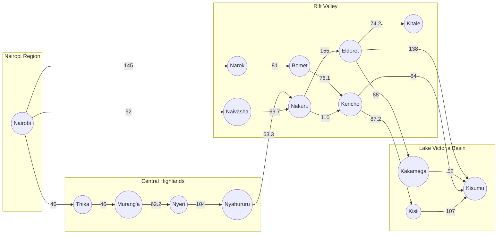
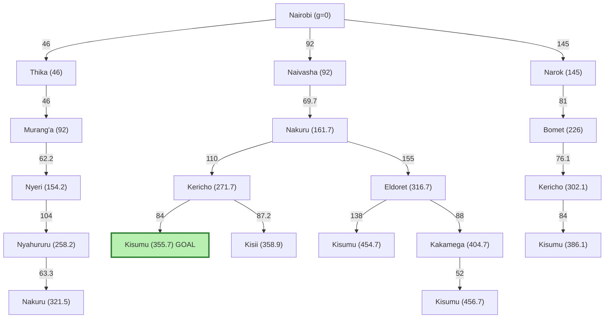

# ICS 3202: Practical Exercise 3 – Designing a Searching Agent

**Agent:** Self-driving trailer (Nairobi → Kisumu)
**Members:**

| Name | Admission No. |
|------|---------------|
| Elvis Mwangi | 184214 |
| Mark Kiplangat | 191241 |
| Mohamed Abdi | 190125 |

---

## 1. PEAS Description of the Self-Driving Trailer Agent

The agent is a self-driving trailer that picks up cargo in Nairobi and has to deliver it to Kisumu using Kenya's highway network. Before it drives anywhere, it has to *search* for a good route, so this is a goal-based, problem-solving agent.

| PEAS | Description |
|------|-------------|
| **Performance measure** | Total distance covered (the shorter the better, since it affects fuel and time), cargo delivered safely and intact, arriving at Kisumu, obeying traffic laws and speed limits, no accidents or collisions, low fuel use, and delivery within the expected time. |
| **Environment** | Kenya's highway network across Nairobi, Central Highlands, Rift Valley and the Lake Victoria Basin: highways (A104, A1, A8 and others), towns and junctions, other vehicles, pedestrians, animals crossing, weather (rain, fog on the escarpment), road works, police checks, and varying road quality. |
| **Actuators** | Steering, accelerator, brakes, gear system, indicators and headlights, horn, wipers, and the screen or alert system that notifies the operator. |
| **Sensors** | GPS, cameras, LiDAR/radar, speedometer, odometer, fuel gauge, cargo weight sensors, tyre pressure sensors, engine sensors, and live traffic and map data. |

### Quick explanation of each part (in my own words)

1. **Performance measure:** This is how we judge if the agent did well. For our search problem, distance is the main one, but safety can never be traded away for a shorter route.
2. **Environment:** Everything the trailer drives through. It is big and messy because real roads have other drivers and surprises.
3. **Actuators:** The parts the agent uses to act on the world, basically what makes the trailer move or signal.
4. **Sensors:** How the agent perceives. GPS tells it where it is, and the cameras and radar tell it what is around it.

---

## 2. Environment Properties

| Property | Classification | Why |
|----------|----------------|-----|
| **Observability** | Partially observable | The sensors only see a limited range. The trailer cannot see an accident round the next bend or know what other drivers are about to do. |
| **Number of agents** | Multi-agent (competitive and cooperative) | Other vehicles, matatus, boda bodas and pedestrians are all agents. We cooperate by following rules and compete a little for road space. |
| **Determinism** | Stochastic | The same action does not always give the same result. Braking on a wet road or a sudden traffic jam changes the outcome. |
| **Episodic vs sequential** | Sequential | Each decision (which town to go to next) affects the later ones and the total cost. One wrong turn changes the whole trip. |
| **Static vs dynamic** | Dynamic | The environment keeps changing while the agent is thinking: traffic, weather and road conditions. |
| **Discrete vs continuous** | Mixed. The route search is **discrete**, driving is **continuous** | Towns and roads form a finite set of states. But speed, steering angle and position are continuous values. |
| **Known vs unknown** | Mostly known | The map and the rules of the road are known, though live road conditions are not. |

**Note:** For the search problem itself (picking a route on the map), we simplify to a **fully observable, single-agent, deterministic, sequential, static, discrete and known** environment. That is what lets us use uninformed search on the graph.

---

## 3. Directed Graph of Kenya's Highway Network

### 3.1 Distances between towns

Distances are approximate road distances in km, taken from Google Maps searches of the form "A to B distance".

| From | To | Distance (km) |
|------|----|---------------|
| Nairobi | Thika | 46 |
| Thika | Murang'a | 46 |
| Murang'a | Nyeri | 62.2 |
| Nyeri | Nyahururu | 104 |
| Nyahururu | Nakuru | 63.3 |
| Nairobi | Naivasha | 92 |
| Naivasha | Nakuru | 69.7 |
| Nairobi | Narok | 145 |
| Narok | Bomet | 81 |
| Bomet | Kericho | 76.1 |
| Nakuru | Kericho | 110 |
| Nakuru | Eldoret | 155 |
| Eldoret | Kitale | 74.2 |
| Eldoret | Kakamega | 88 |
| Eldoret | Kisumu | 138 |
| Kakamega | Kisumu | 52 |
| Kericho | Kisumu | 84 |
| Kericho | Kisii | 87.2 |
| Kisii | Kisumu | 107 |

> Roads are two-way in real life, but since the trailer is travelling **from Nairobi towards Kisumu**, we draw the graph as directed edges pointing in the direction of travel. This also stops the agent from going backwards in circles.

### 3.2 The graph

### 3.3 Problem formulation

1. **Initial state:** In(Nairobi)
2. **Actions:** Drive(town A, town B), only along an edge that exists on the graph
3. **Transition model:** Result(In(A), Drive(A, B)) = In(B)
4. **Goal test:** Is the current state In(Kisumu)?
5. **Path cost:** Sum of the distances (km) of the edges travelled, so each step cost is the distance between the two towns

---

## 4. Search Tree (with Abstraction)

### 4.1 What abstraction means here

The real trip has a lot of detail: junctions, small trading centres (Limuru, Gilgil, Mau Summit, Muhoroni and so on), road bends, and so on. If we included all of that the tree would be huge and useless for planning. So we **abstract**:

1. **Abstract states:** We only keep major towns as states and ignore small stops in between. For example "Nairobi → Naivasha" is one step, even though the real road passes through Limuru and Mai Mahiu.
2. **Abstract actions:** "Drive from Nairobi to Naivasha" is one action. We ignore steering, braking and gear changes, because those are handled by the lower level driving controller.
3. **Abstract costs:** Each step cost is the whole road distance between two towns, not every small segment.
4. **Removing irrelevant branches:** Kitale, and dead ends that lead away from Kisumu, are pruned in the tree since they cannot lead to the goal efficiently.

### 4.2 Search tree (expanded from Nairobi, path cost g shown in brackets)

The green branch is the optimal solution.

### 4.3 Higher level abstraction (regions)

At an even higher level of abstraction, we can treat each region as a single node. This is what the trailer uses to decide the *general* direction before it plans the detailed town level route.

So the abstract plan is: **Nairobi region → Rift Valley → Lake Victoria Basin**. The detailed plan then fills in the towns within each region.

---

## 5. Optimal Path from Nairobi to Kisumu

I used **Uniform Cost Search (UCS)** because the path cost is distance, so it always expands the node with the lowest cumulative cost first and is guaranteed to give the cheapest path.

### 5.1 Candidate paths and their costs

| # | Path | Calculation | Total (km) |
|---|------|-------------|------------|
| 1 | Nairobi → Naivasha → Nakuru → **Kericho** → Kisumu | 92 + 69.7 + 110 + 84 | **355.7** |
| 2 | Nairobi → Narok → Bomet → Kericho → Kisumu | 145 + 81 + 76.1 + 84 | 386.1 |
| 3 | Nairobi → Naivasha → Nakuru → Eldoret → Kisumu | 92 + 69.7 + 155 + 138 | 454.7 |
| 4 | Nairobi → Naivasha → Nakuru → Eldoret → Kakamega → Kisumu | 92 + 69.7 + 155 + 88 + 52 | 456.7 |
| 5 | Nairobi → Thika → Murang'a → Nyeri → Nyahururu → Nakuru → Kericho → Kisumu | 46 + 46 + 62.2 + 104 + 63.3 + 110 + 84 | 515.5 |

### 5.2 UCS trace (order of expansion)

| Step | Node expanded | Cost so far g(n) | Frontier after expanding (node: g) |
|------|---------------|------------------|-------------------------------------|
| 1 | Nairobi | 0 | Thika: 46, Naivasha: 92, Narok: 145 |
| 2 | Thika | 46 | Murang'a: 92, Naivasha: 92, Narok: 145 |
| 3 | Murang'a | 92 | Naivasha: 92, Narok: 145, Nyeri: 154.2 |
| 4 | Naivasha | 92 | Narok: 145, Nyeri: 154.2, Nakuru: 161.7 |
| 5 | Narok | 145 | Nyeri: 154.2, Nakuru: 161.7, Bomet: 226 |
| 6 | Nyeri | 154.2 | Nakuru: 161.7, Bomet: 226, Nyahururu: 258.2 |
| 7 | Nakuru | 161.7 | Bomet: 226, Nyahururu: 258.2, Kericho: 271.7, Eldoret: 316.7 |
| 8 | Bomet | 226 | Nyahururu: 258.2, Kericho: 271.7, Eldoret: 316.7 (Kericho via Bomet = 302.1, not better) |
| 9 | Nyahururu | 258.2 | Kericho: 271.7, Eldoret: 316.7 (Nakuru via Nyahururu = 321.5, not better) |
| 10 | Kericho | 271.7 | Eldoret: 316.7, Kisumu: 355.7, Kisii: 358.9 |
| 11 | Eldoret | 316.7 | Kisumu: 355.7 (via Kericho, better than 454.7), Kisii: 358.9, Kitale: 390.9, Kakamega: 404.7 |
| 12 | Kisumu | 355.7 | **Goal reached** |

### 5.3 Answer

**Optimal path:** Nairobi → Naivasha → Nakuru → Kericho → Kisumu

**Total path cost: 92 + 69.7 + 110 + 84 = 355.7 km**

Why it works: going through Naivasha to Nakuru is the shortest way into the Rift Valley, and from Nakuru the Kericho route is much shorter than the Eldoret route (110 + 84 = 194 km compared with 155 + 138 = 293 km).

---

## 6. Evidence of Group Work

### Meeting Minutes

| | |
|---|---|
| **Date** | 14/10/2026 |
| **Venue / platform** | Students Center |
| **Present** | Elvis Mwangi, Mark Kiplangat, Mohamed Abdi |
| **Absent (with apologies)** | None, all members present |

**Agenda:** PEAS design, environment properties, graph and tree, path cost calculation.

**Discussion and contributions:**

| Member | Contribution |
|--------|--------------|
| Elvis Mwangi | PEAS table and explanations; environment properties; compiling everything into design.md and setting up the PS-Agents repository |
| Mark Kiplangat | Directed graph and problem formulation; collecting and checking the distances between towns on Google Maps |
| Mohamed Abdi | Search tree with abstraction (town level and region level); path cost calculations and the UCS trace to find the optimal path |
| All members | Reviewed the whole document together and agreed on the final answer (Nairobi → Naivasha → Nakuru → Kericho → Kisumu, 355.7 km) |

**Meeting closed at:** 1500hrs

---

## Submission Checklist

- [ ] Repository named exactly **PS-Agents**
- [ ] This file saved as **design.md** in the repository
- [ ] All members have forked or contributed (commits visible)
- [ ] Group work evidence added in Section 6
- [ ] Distances re-checked on Google Maps
- [ ] Repository link submitted on e-learning by **one** member only
